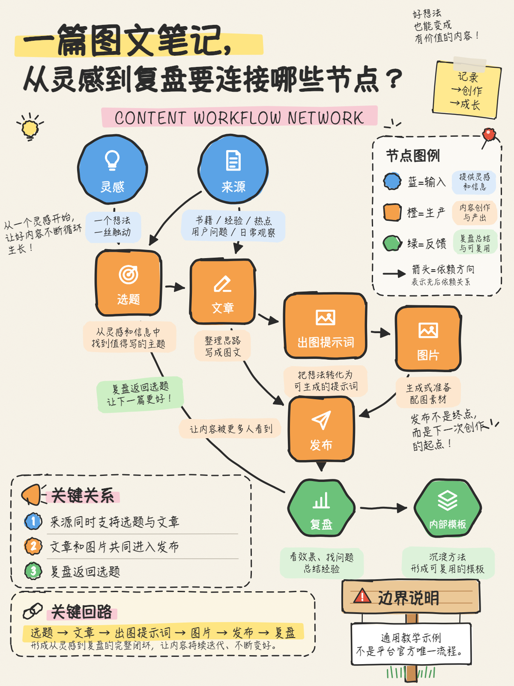
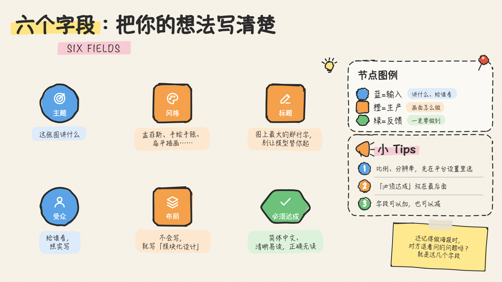

# 陆苍的 Skill 库

陆苍做 AI 图文创作时自己在用的 [Agent Skills](https://agentskills.io)，整理出来公开分享。一个文件夹一个 skill，放在 `skills/` 下。Claude Code、Codex 等支持 skill 的 AI 工具都能用。

| Skill | 做什么 |
|---|---|
| [sketchnote-diagram](skills/sketchnote-diagram/SKILL.md) | 用代码画手绘笔记风的中文教学配图：写一份 JSON，出一张 PNG，图里的字一个不错 |

## 安装

**用 skills 命令行**（需要 Node.js）：

```bash
npx skills add pengmn23/lucang-skills
```

**手动装**：下载这个仓库，把 `skills/` 里想用的文件夹放进 AI 工具的 skill 目录：

| 工具 | 只给一个项目用 | 所有项目都能用 |
|---|---|---|
| Claude Code | `<项目>/.claude/skills/` | `~/.claude/skills/` |
| Codex | `<项目>/.agents/skills/` | `~/.codex/skills/` |

```bash
git clone https://github.com/pengmn23/lucang-skills.git
cp -R lucang-skills/skills/sketchnote-diagram ~/.claude/skills/
```

装好后直接说需求就行，比如「用配图工具把这一段画成一张流程图」。

---

## sketchnote-diagram：手绘笔记风配图



奶油色纸底、黑色马克笔线条，蓝圆、橙方、绿六边形三种节点分别表示输入、生产、反馈，加上荧光笔高亮、手写批注和小涂鸦。

- **文字不出错**：图里每个字都来自 JSON。生图模型写中文常常错字，这里不会。
- **好改**：改一个字、挪一个节点，重新出图只要几秒；也可以在浏览器里直接拖动、双击改字，⌘S 存回。
- **自带检查**：`--check` 会列出重叠、超出画布的地方。
- **5 个模板**：流程闭环、上下两组对比、四步循环、空白横版、竖版 3:4。



**需要**：macOS（用系统自带的「手札体」「翩翩体」）、Google Chrome（或 Microsoft Edge）、Python 3。

**自己用命令行**：

```bash
cd 你的项目
R=~/.claude/skills/sketchnote-diagram/scripts/render.py
python3 $R --list-templates              # 看模板
python3 $R --new 01_01_封面 --from 1      # 从模板新建 specs/01_01_封面.json
python3 $R --check specs/01_01_封面.json  # 检查排版
python3 $R specs/01_01_封面.json 封面.png   # 出图（3200×1800）
python3 $R --edit specs/01_01_封面.json   # 在 Chrome 里打开编辑器
```

或者双击 `scripts/打开配图工具.command`，在浏览器里从模板新建。JSON 的写法见 [json-format.md](skills/sketchnote-diagram/references/json-format.md)，风格规定见 [style.md](skills/sketchnote-diagram/references/style.md)。

## 许可

[MIT](LICENSE)
